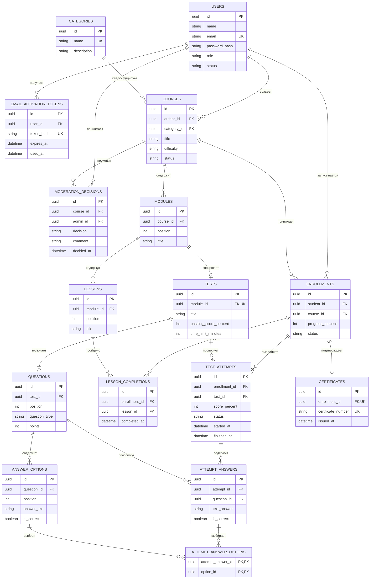

# Логическая схема базы данных

## 1. Назначение и основания модели
Документ описывает логическую реляционную модель базы данных веб-приложения для организации онлайн-обучения и тестирования (команда № 10). Модель спроектирована на основании требований документов «Видение», «Бизнес-процессы», «Термины», «Модель предметной области», «Варианты использования», «Сценарии» и макетов этапа «04-Дизайнер».

Модель сохраняет ключевые сущности предметной области: пользователь, категория курса, курс, модуль, занятие, тест, вопрос, вариант ответа, запись на курс, прохождение занятия, попытка тестирования, сертификат. Технические сущности («Токен активации», «Ответ на вопрос», «Выбранный вариант», «Решение модерации») обеспечивают персистентность процессов регистрации, проверки тестов и модерации без изменения границ бизнес-логики.

---

## 2. Логическая ER-диаграмма

---

## 3. Перечень отношений и логические ключи

| Отношение | Первичный ключ | Основные внешние ключи | Уникальные ограничения |
|---|---|---|---|
| `users` | `id` | — | `email` |
| `email_activation_tokens` | `id` | `user_id → users` | `token_hash` |
| `categories` | `id` | — | `name` |
| `courses` | `id` | `author_id → users`, `category_id → categories` | — |
| `modules` | `id` | `course_id → courses` | `(course_id, position)` |
| `lessons` | `id` | `module_id → modules` | `(module_id, position)` |
| `tests` | `id` | `module_id → modules` | `module_id` |
| `questions` | `id` | `test_id → tests` | `(test_id, position)` |
| `answer_options` | `id` | `question_id → questions` | `(question_id, position)` |
| `enrollments` | `id` | `student_id → users`, `course_id → courses` | `(student_id, course_id)` |
| `lesson_completions` | `id` | `enrollment_id → enrollments`, `lesson_id → lessons` | `(enrollment_id, lesson_id)` |
| `test_attempts` | `id` | `enrollment_id → enrollments`, `test_id → tests` | — |
| `attempt_answers` | `id` | `attempt_id → test_attempts`, `question_id → questions` | `(attempt_id, question_id)` |
| `attempt_answer_options` | `(attempt_answer_id, option_id)` | `attempt_answer_id → attempt_answers`, `option_id → answer_options` | составной PK |
| `certificates` | `id` | `enrollment_id → enrollments` | `enrollment_id`, `certificate_number` |
| `moderation_decisions` | `id` | `course_id → courses`, `admin_id → users` | — |

---

## 4. Логические ограничения и правила

1. **Ролевая модель:** Роли пользователей ограничены значениями `student`, `teacher`, `admin`. Специализированные акторы из диаграммы прецедентов реализованы единой таблицей учётных записей с атрибутом роли. Неавторизованный актор «Гость» не персистируется в базе данных. Публичная форма регистрации позволяет выбрать исключительно роль студента или преподавателя; учётная запись администратора инициализируется служебным скриптом.
2. **Статусы сущностей:** 
   - Аккаунт: `inactive` (до подтверждения email), `active` (активен), `blocked` (заблокирован администратором).
   - Курс: `draft` (черновик), `pending` (на модерации), `published` (опубликован в каталоге).
   - Обучение: `active` (в процессе), `completed` (завершен), `withdrawn` (отчислен).
   - Попытка тестирования: `in_progress` (идет сдача), `passed` (сдан успешно), `failed` (не сдан).
3. **Публикация курсов:** Перевод курса в статус `pending` и `published` допускается только при наличии заполненных модулей, уроков и тестов. При отклонении администратором фиксируется запись в `moderation_decisions`, а статус курса возвращается в `draft`.
4. **Зачисление на курс:** Запись студента на курс (`enrollments`) возможна только для опубликованных курсов. Ограничение уникальности `(student_id, course_id)` исключает дублирование записей.
5. **Прохождение занятий:** Фиксация завершения урока (`lesson_completions`) уникальна для пары «зачисление — занятие». Прикладной уровень валидирует принадлежность урока курсу данного зачисления.
6. **Тестирование знаний:** При создании попытки фиксируется временная метка старта `started_at` и предельная длительность. Итоговый процент вычисляется по сумме набранных баллов за вопросы; статус `passed` выставляется при выполнении условия `score_percent >= passing_score_percent`.
7. **Типы вопросов:** Поддерживаются вопросы с одиночным выбором (`single`), множественным выбором (`multiple`) и текстовым вводом (`text`). Эталонные ответы хранятся в `answer_options` и не передаются клиенту до завершения попытки.
8. **Расчёт прогресса:** Атрибуты `score_percent` и `progress_percent` ограничены диапазоном от 0 до 100%. Прогресс обучения пересчитывается транзакционно на основании долей завершенных занятий и успешно сданных тестов.
9. **Сертификация:** Сертификат формируется строго в единственном экземпляре на зачисление при достижении 100% прогресса курса.
10. **Безопасность:** В базе данных сохраняются криптографические хеши паролей и токенов подтверждения почты. Исходные значения токенов и паролей в персистентное хранилище не передаются.

---

## 5. Нормализация данных

Логическая модель соответствует **третьей нормальной форме (3НФ)**:
- Все атрибуты атомарны (1НФ);
- Все неключевые атрибуты функционально полно зависят от первичного ключа соответствующего отношения (2НФ);
- Отсутствуют транзитивные функциональные зависимости между неключевыми атрибутами (3НФ).

Связи типа «многие-ко-многим» декомпозированы через связующие сущности (`enrollments`, `lesson_completions`, `attempt_answer_options`). Поля `progress_percent` и `score_percent` являются контролируемой денормализацией для исключения ресурсоёмких агрегационных запросов при отрисовке личного кабинета и сопровождаются транзакционным пересчётом.

---

## 6. Связь с артефактами требований

| Таблицы и сущности базы данных | Исходные прецеденты и бизнес-процессы |
|---|---|
| `users`, `email_activation_tokens` | БП-1.1, БП-1.2, БП-1.3; ВИ-1.1, ВИ-1.2, ВИ-1.3 |
| `categories`, `courses`, `modules`, `lessons` | БП-2.1, БП-2.3; ВИ-2.1, ВИ-4.1, ВИ-4.2, ВИ-5.2 |
| `tests`, `questions`, `answer_options` | БП-2.2; ВИ-4.3 |
| `enrollments`, `lesson_completions` | БП-3.1, БП-3.2; ВИ-2.3, ВИ-3.1, ВИ-3.2 |
| `test_attempts`, `attempt_answers`, `attempt_answer_options` | БП-3.3; ВИ-3.3 |
| `certificates` | БП-3.4; ВИ-3.4 |
| `moderation_decisions` | БП-2.3; ВИ-5.1 |
