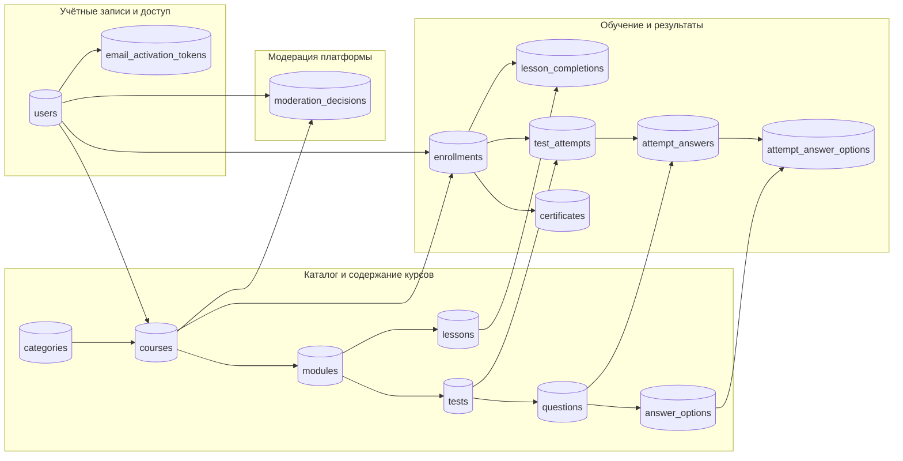

# Физическая схема базы данных

## 1. Среда и принципы реализации
Целевой системой управления базами данных является **PostgreSQL 14+** в соответствии с требованиями к архитектуре хранения данных. На физическом уровне применяются первичные ключи типа `uuid` со встроенной генерацией `gen_random_uuid()`, временные метки с часовыми поясами `timestamptz`, строковые типы фиксированной и переменной длины с ограничениями `CHECK`, а также внешние ключи и уникальные индексы.

Физическая структура строго реализует реляционную целостность: каскадное удаление применяется исключительно к жестко подчиненным сущностям учебного контента и попыток, тогда как пользователи, курсы и категории защищены ограничениями `RESTRICT`.

---

## 2. Физическая ER-схема



---

## 3. Физическая спецификация таблиц

| Таблица | Столбцы и физические типы | Ограничения и индексы |
|---|---|---|
| `users` | `id uuid PK`, `name varchar(150)`, `email varchar(254)`, `password_hash text`, `role varchar(16)`, `status varchar(16)`, `created_at timestamptz`, `updated_at timestamptz` | `UNIQUE(email)`, `CHECK(role IN ('student','teacher','admin'))`, `CHECK(status IN ('inactive','active','blocked'))` |
| `email_activation_tokens` | `id uuid PK`, `user_id uuid FK`, `token_hash varchar(128)`, `expires_at timestamptz`, `used_at timestamptz`, `created_at timestamptz` | `UNIQUE(token_hash)`, `FK users(id) ON DELETE CASCADE`, `CHECK(expires_at > created_at)` |
| `categories` | `id uuid PK`, `name varchar(120)`, `description text` | `UNIQUE(name)`, `CHECK(length(trim(name)) > 0)` |
| `courses` | `id uuid PK`, `author_id uuid FK`, `category_id uuid FK`, `title varchar(200)`, `description text`, `difficulty varchar(20)`, `status varchar(16)`, `created_at timestamptz`, `updated_at timestamptz` | `FK users(id) ON DELETE RESTRICT`, `FK categories(id) ON DELETE RESTRICT`, `CHECK(difficulty IN ('beginner','intermediate','advanced'))`, `CHECK(status IN ('draft','pending','published'))` |
| `modules` | `id uuid PK`, `course_id uuid FK`, `position int`, `title varchar(200)`, `description text` | `FK courses(id) ON DELETE CASCADE`, `UNIQUE(course_id, position)`, `CHECK(position > 0)` |
| `lessons` | `id uuid PK`, `module_id uuid FK`, `position int`, `title varchar(200)`, `content text` | `FK modules(id) ON DELETE CASCADE`, `UNIQUE(module_id, position)`, `CHECK(position > 0)` |
| `tests` | `id uuid PK`, `module_id uuid FK`, `title varchar(200)`, `passing_score_percent smallint`, `time_limit_minutes int` | `FK modules(id) ON DELETE CASCADE`, `UNIQUE(module_id)`, `CHECK(passing_score_percent BETWEEN 0 AND 100)`, `CHECK(time_limit_minutes > 0)` |
| `questions` | `id uuid PK`, `test_id uuid FK`, `position int`, `question_text text`, `question_type varchar(20)`, `points int` | `FK tests(id) ON DELETE CASCADE`, `UNIQUE(test_id, position)`, `CHECK(question_type IN ('single','multiple','text'))`, `CHECK(points > 0)` |
| `answer_options` | `id uuid PK`, `question_id uuid FK`, `position int`, `answer_text text`, `is_correct boolean` | `FK questions(id) ON DELETE CASCADE`, `UNIQUE(question_id, position)` |
| `enrollments` | `id uuid PK`, `student_id uuid FK`, `course_id uuid FK`, `progress_percent smallint`, `status varchar(16)`, `enrolled_at timestamptz` | `FK users(id) ON DELETE RESTRICT`, `FK courses(id) ON DELETE RESTRICT`, `UNIQUE(student_id, course_id)`, `CHECK(progress_percent BETWEEN 0 AND 100)` |
| `lesson_completions` | `id uuid PK`, `enrollment_id uuid FK`, `lesson_id uuid FK`, `completed_at timestamptz` | `FK enrollments(id) ON DELETE CASCADE`, `FK lessons(id) ON DELETE RESTRICT`, `UNIQUE(enrollment_id, lesson_id)` |
| `test_attempts` | `id uuid PK`, `enrollment_id uuid FK`, `test_id uuid FK`, `score_percent smallint`, `status varchar(16)`, `started_at timestamptz`, `finished_at timestamptz` | `FK enrollments(id) ON DELETE CASCADE`, `FK tests(id) ON DELETE RESTRICT`, `CHECK(status IN ('in_progress','passed','failed'))` |
| `attempt_answers` | `id uuid PK`, `attempt_id uuid FK`, `question_id uuid FK`, `text_answer text`, `is_correct boolean` | `FK test_attempts(id) ON DELETE CASCADE`, `FK questions(id) ON DELETE RESTRICT`, `UNIQUE(attempt_id, question_id)` |
| `attempt_answer_options` | `attempt_answer_id uuid FK`, `option_id uuid FK` | Составной первичный ключ `PRIMARY KEY(attempt_answer_id, option_id)` |
| `certificates` | `id uuid PK`, `enrollment_id uuid FK`, `certificate_number varchar(64)`, `issued_at timestamptz` | `FK enrollments(id) ON DELETE RESTRICT`, `UNIQUE(enrollment_id)`, `UNIQUE(certificate_number)` |
| `moderation_decisions` | `id uuid PK`, `course_id uuid FK`, `admin_id uuid FK`, `decision varchar(12)`, `comment text`, `decided_at timestamptz` | `FK courses(id) ON DELETE RESTRICT`, `FK users(id) ON DELETE RESTRICT`, `CHECK(decision IN ('approved','rejected'))` |

---

## 4. Ограничения связности и правила удаления

1. **Защита целостности истории (`RESTRICT`):**
   - Пользователи, курсы и категории, имеющие связанные зачисления, сертификаты или учебную историю, защищены от физического удаления.
   - Для прекращения доступа пользователя используется перевод статуса в `blocked`.
   - Для прекращения набора на курс используется снятие с публикации в каталоге.
2. **Каскадное очищение подчиненных данных (`CASCADE`):**
   - При удалении курса на этапе черновика автоматически удаляются все его модули, уроки и тестовые задания.
   - При удалении попытки тестирования каскадно очищаются детальные ответы студента и выбранные опции.
   - При удалении пользователя каскадно аннулируются неиспользованные токены активации почты.

---

## 5. Индексы и оптимизация производительности

Для обеспечения целевых показателей времени отклика прикладного API (не более 300 мс на чтение и не более 500 мс на запись) созданы следующие специализированные индексы:

| Название индекса | Таблица и индексируемые поля | Оптимизируемый сценарий |
|---|---|---|
| `idx_users_email` | `users(email)` | Ускорение аутентификации и проверки уникальности email при регистрации |
| `idx_activation_tokens_user` | `email_activation_tokens(user_id, expires_at)` | Валидация токена подтверждения электронной почты |
| `idx_courses_catalog` | `courses(status, category_id, difficulty)` | Фильтрация и пагинация публичного каталога курсов |
| `idx_courses_author` | `courses(author_id, status)` | Выборка списка авторских курсов в кабинете преподавателя |
| `idx_modules_course_pos` | `modules(course_id, position)` | Последовательная отрисовка структуры программы курса |
| `idx_lessons_module_pos` | `lessons(module_id, position)` | Постраничная навигация по урокам модуля |
| `idx_enrollments_student` | `enrollments(student_id, status)` | Отрисовка реестра «Мои курсы» студента с текущим прогрессом |
| `idx_lesson_completions_enr` | `lesson_completions(enrollment_id)` | Быстрый подсчет завершенных уроков при пересчете прогресса |
| `idx_attempts_enr_test` | `test_attempts(enrollment_id, test_id, started_at DESC)` | Контроль лимитов попыток и получение лучшего результата тестирования |
| `idx_moderation_course_date`| `moderation_decisions(course_id, decided_at DESC)` | Получение замечаний модератора автором курса |

---

## 6. Примеры запросов к физической схеме

### 6.1. Выборка опубликованных курсов для каталога с фильтрацией

```sql
SELECT c.id, c.title, c.difficulty, cat.name AS category_name, u.name AS author_name,
       COUNT(DISTINCT l.id) AS total_lessons,
       COUNT(DISTINCT t.id) AS total_tests
FROM courses c
JOIN categories cat ON cat.id = c.category_id
JOIN users u ON u.id = c.author_id
LEFT JOIN modules m ON m.course_id = c.id
LEFT JOIN lessons l ON l.module_id = m.id
LEFT JOIN tests t ON t.module_id = m.id
WHERE c.status = 'published' AND cat.id = :category_id
GROUP BY c.id, c.title, c.difficulty, cat.name, u.name
ORDER BY c.created_at DESC
LIMIT 12 OFFSET 0;
```

### 6.2. Получение текущего прогресса студента по курсу

```sql
SELECT e.id AS enrollment_id, e.progress_percent, e.status,
       COUNT(DISTINCT lc.lesson_id) AS completed_lessons,
       COUNT(DISTINCT CASE WHEN ta.status = 'passed' THEN ta.test_id END) AS passed_tests,
       cert.certificate_number
FROM enrollments e
LEFT JOIN lesson_completions lc ON lc.enrollment_id = e.id
LEFT JOIN test_attempts ta ON ta.enrollment_id = e.id AND ta.status = 'passed'
LEFT JOIN certificates cert ON cert.enrollment_id = e.id
WHERE e.student_id = :student_id AND e.course_id = :course_id
GROUP BY e.id, e.progress_percent, e.status, cert.certificate_number;
```
