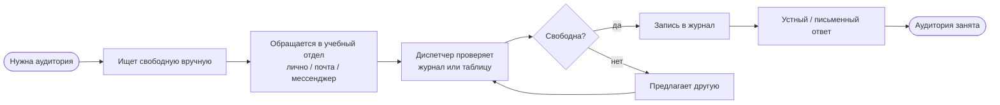
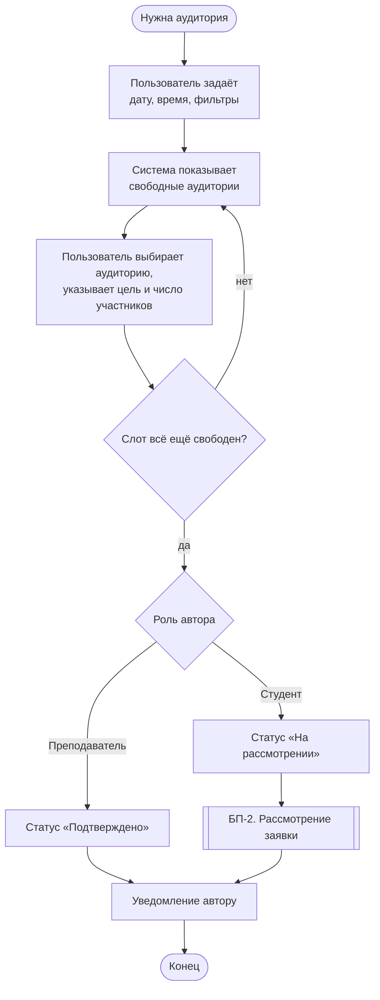
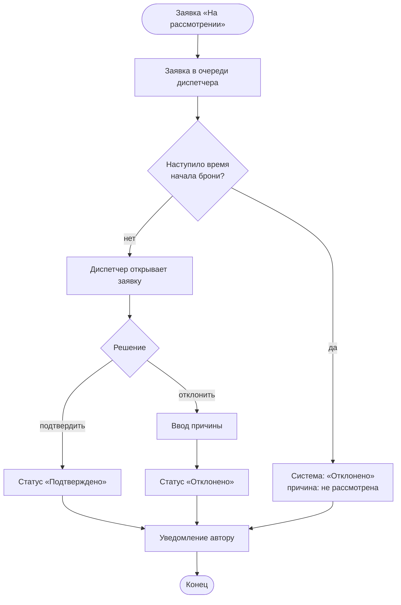
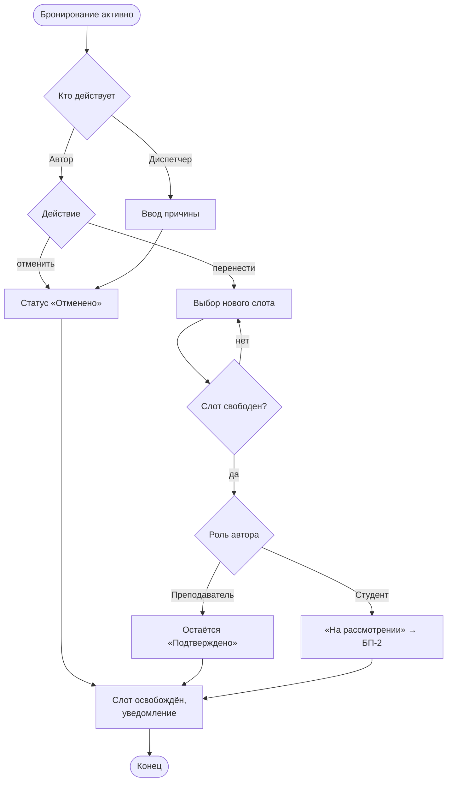
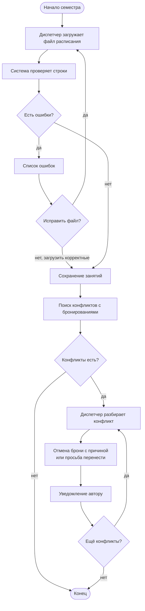

# Бизнес-процессы

Описаны процессы «как есть» (AS-IS) и «как будет» с RoomBook (TO-BE).
Диаграммы — в нотации Mermaid (отображаются в GitLab/GitHub).

## 1. AS-IS: бронирование аудитории сейчас

1. Пользователь ищет свободную аудиторию: спрашивает коллег, смотрит бумажное расписание у двери, идёт на вахту.
2. Обращается в учебный отдел лично, по почте или в мессенджере.
3. Диспетчер проверяет занятость по таблице или журналу.
4. Если свободно — записывает бронирование и сообщает ответ; если нет — предлагает другую аудиторию.
5. Учёт ведётся вручную; вахта о бронировании не знает.

**Проблемы AS-IS:** несколько каналов заявок; ручная проверка конфликтов; ответ занимает время; нет прозрачности для вахты и других пользователей.

---

## 2. TO-BE: БП-1. Бронирование аудитории

Участники: Студент / Преподаватель, Система, Диспетчер.

1. Пользователь задаёт дату, время, требования (вместимость, оборудование, корпус).
2. Система показывает свободные аудитории.
3. Пользователь выбирает аудиторию, указывает цель и число участников.
4. Система повторно проверяет конфликт (слот мог быть занят, пока пользователь заполнял форму).
5. Если автор — **преподаватель**, бронирование сразу **подтверждается**.
6. Если автор — **студент**, создаётся заявка **«На рассмотрении»** и передаётся в БП-2.
7. Пользователь получает уведомление о результате.

## 3. TO-BE: БП-2. Рассмотрение заявки студента

1. Заявка появляется в очереди диспетчера.
2. Диспетчер открывает заявку, проверяет цель, число участников и уместность.
3. Диспетчер подтверждает или отклоняет заявку (при отклонении указывает причину).
4. Если заявка не рассмотрена до начала бронирования — система автоматически переводит её в «Отклонено» с причиной «Не рассмотрена вовремя».
5. Автор получает уведомление.

## 4. TO-BE: БП-3. Отмена и перенос бронирования

1. Автор открывает своё бронирование (статус «На рассмотрении» или «Подтверждено», время ещё не наступило).
2. **Отмена:** статус → «Отменено», слот освобождается.
3. **Перенос:** автор выбирает новый слот → система проверяет конфликт → для преподавателя бронирование остаётся подтверждённым, для студента снова уходит на рассмотрение (БП-2).
4. Диспетчер может отменить любое бронирование с указанием причины — автор получает уведомление.

## 5. TO-BE: БП-4. Ведение аудиторного фонда и основного расписания

1. Диспетчер ведёт справочник корпусов (часы работы) и аудиторий (вместимость, оборудование, доступность).
2. В начале семестра диспетчер загружает файл основного расписания.
3. Система проверяет файл: неизвестные аудитории, неверное время — выводятся как ошибки строк.
4. Корректные занятия сохраняются и блокируют слоты.
5. Система ищет бронирования, пересекающиеся с новыми занятиями, и формирует **список конфликтов**.
6. По каждому конфликту диспетчер решает: отменить бронирование (автор уведомляется) или предложить автору другую аудиторию (автор переносит сам — БП-3).

## 6. Связь процессов и пользовательских историй

| Процесс | Истории |
|---|---|
| БП-1 Бронирование | US-02, US-03, US-07, US-10 |
| БП-2 Рассмотрение заявки | US-08, US-12, US-13 |
| БП-3 Отмена и перенос | US-05, US-11, US-17 |
| БП-4 Фонд и расписание | US-14, US-15, US-16, US-18 |
| Сквозное: уведомления | US-06 |
