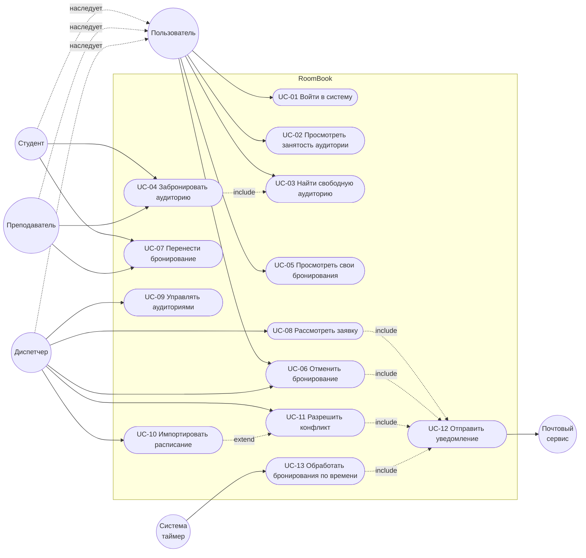

# Варианты использования

## 1. Актёры

| Актёр | Описание |
|---|---|
| **Пользователь** | Обобщённый актёр: любой вошедший в систему. |
| **Студент** | Наследует Пользователя. Бронирования требуют подтверждения. |
| **Преподаватель** | Наследует Пользователя. Бронирования подтверждаются автоматически. |
| **Диспетчер** | Наследует Пользователя. Управляет фондом, расписанием и заявками. |
| **Система (таймер)** | Внутренний актёр: выполняет действия по времени (завершение и автоотклонение бронирований). |
| **Почтовый сервис** | Внешняя система для отправки e-mail-уведомлений. |

## 2. Диаграмма вариантов использования

## 3. Перечень вариантов использования

| ID | Название | Актёры | Краткое описание | Истории |
|---|---|---|---|---|
| UC-01 | Войти в систему | Пользователь | Вход по университетскому e-mail и паролю. | US-01 |
| UC-02 | Просмотреть занятость аудитории | Пользователь | Календарь на день/неделю: занятия и подтверждённые бронирования. | US-02 |
| UC-03 | Найти свободную аудиторию | Пользователь | Поиск по дате, времени, корпусу, вместимости, оборудованию. | US-03 |
| UC-04 | Забронировать аудиторию | Студент, Преподаватель | Создание бронирования; для студента — заявка, для преподавателя — сразу подтверждено. | US-07, US-09, US-10 |
| UC-05 | Просмотреть свои бронирования | Пользователь | Список в личном кабинете с фильтром по статусу. | US-04, US-08 |
| UC-06 | Отменить бронирование | Пользователь, Диспетчер | Автор отменяет своё; диспетчер — любое с причиной. | US-05, US-17 |
| UC-07 | Перенести бронирование | Студент, Преподаватель | Смена слота с проверкой конфликта. | US-11 |
| UC-08 | Рассмотреть заявку | Диспетчер | Подтверждение или отклонение заявки студента. | US-12, US-13 |
| UC-09 | Управлять аудиториями | Диспетчер | CRUD корпусов, аудиторий, оборудования, часы работы. | US-14, US-18 |
| UC-10 | Импортировать расписание | Диспетчер | Загрузка файла основного расписания с проверкой. | US-15 |
| UC-11 | Разрешить конфликт | Диспетчер | Обработка бронирований, пересекающихся с расписанием. | US-16 |
| UC-12 | Отправить уведомление | — (вызывается другими UC) | Создание уведомления в кабинете и отправка e-mail. | US-06 |
| UC-13 | Обработать бронирования по времени | Система (таймер) | Перевод прошедших в «Завершено», нерассмотренных — в «Отклонено». | — |

Подробные сценарии — в документе [Сценарии](Сценарии.md).
