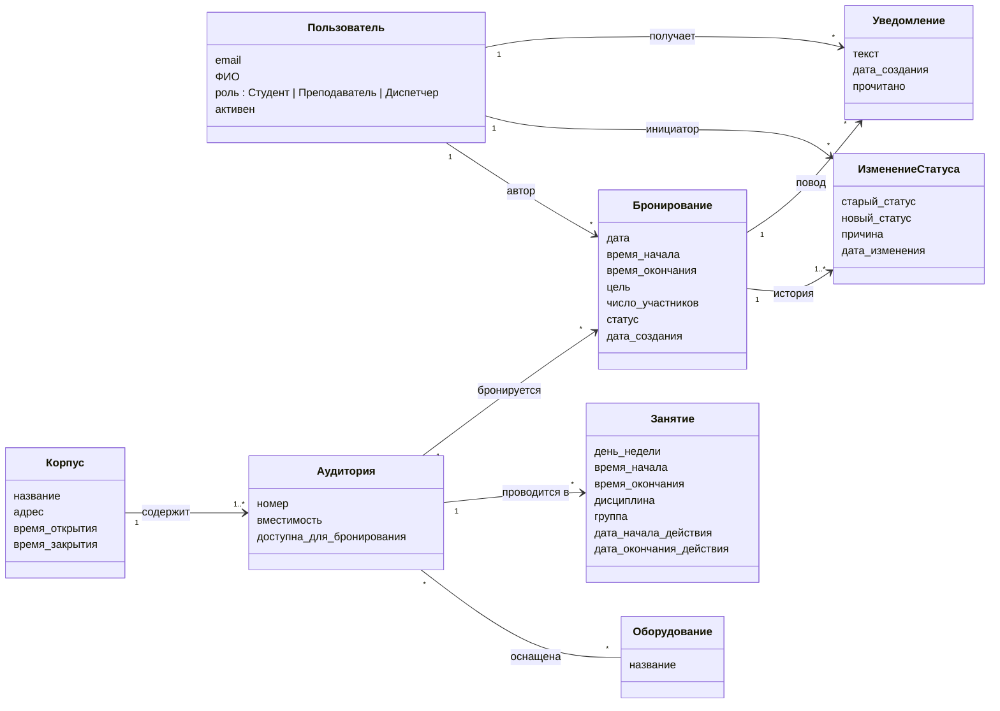
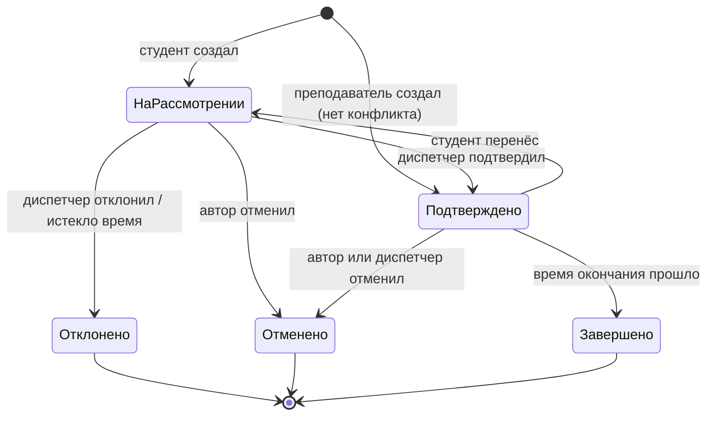

# Модель предметной области

Модель описывает понятия предметной области и связи между ними (без деталей реализации).
Названия сущностей соответствуют документу [Термины](../02-Бизнес-аналитик/Термины.md).

## 1. Диаграмма классов

## 2. Описание сущностей

| Сущность | Описание | Ключевые правила |
|---|---|---|
| **Пользователь** | Человек, работающий с системой. Роль определяет права. | E-mail уникален и принадлежит домену университета. |
| **Корпус** | Здание с аудиториями. | Часы работы ограничивают время бронирования. |
| **Аудитория** | Помещение, доступное для занятий и бронирования. | Номер уникален в пределах корпуса; вместимость > 0. Недоступная аудитория не участвует в поиске. |
| **Оборудование** | Тип оборудования (проектор, ПК, доска и т. п.). | Связь с аудиторией многие-ко-многим. |
| **Занятие** | Повторяющаяся еженедельная запись основного расписания. | Действует в интервале дат семестра; имеет приоритет над бронированиями. |
| **Бронирование** | Разовое закрепление аудитории за пользователем. | Время в пределах часов работы корпуса; начало < окончания; число участников ≤ вместимости; не пересекается с занятиями и с подтверждёнными бронированиями той же аудитории. |
| **ИзменениеСтатуса** | Запись истории: кто, когда и почему изменил статус. | При отклонении и отмене диспетчером причина обязательна. |
| **Уведомление** | Сообщение пользователю о событии с бронированием. | Создаётся системой при каждой смене статуса чужим действием (диспетчер или система). |

## 3. Жизненный цикл бронирования

| Статус | Занимает слот? | Можно изменить? |
|---|---|---|
| На рассмотрении | нет (виден диспетчеру как претендент) | да — автор, диспетчер |
| Подтверждено | да | да — до начала |
| Отклонено | нет | нет (конечный) |
| Отменено | нет | нет (конечный) |
| Завершено | — | нет (конечный) |

## 4. Права ролей по сущностям

| Сущность | Студент | Преподаватель | Диспетчер |
|---|---|---|---|
| Корпус, Аудитория, Оборудование | просмотр | просмотр | создание, изменение |
| Занятие | просмотр | просмотр | импорт, изменение |
| Бронирование (своё) | создание (на рассмотрение), отмена, перенос | создание (сразу подтверждено), отмена, перенос | — |
| Бронирование (чужое) | просмотр занятости | просмотр занятости | подтверждение, отклонение, отмена |
| Уведомление | свои | свои | свои |
