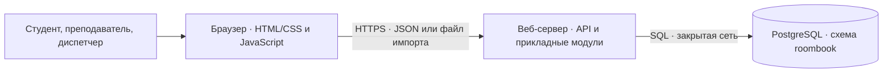

# Архитектура RoomBook

RoomBook — клиент-серверное приложение для поиска и бронирования аудиторий. Для первой версии предлагается модульный монолит: один сервер приложения и одна база PostgreSQL. Модули взаимодействуют внутри процесса и могут участвовать в общей транзакции.

- **Клиент** отображает экраны этапа 04 и передаёт запросы серверу. Формы помогают обнаружить ошибки ввода, права и данные проверяет сервер.
- **Сервер** обслуживает интерфейс и API одного источника. Сессия хранится на сервере, идентификатор передаётся в cookie с `HttpOnly`, `Secure` и `SameSite`. Изменяющие запросы проходят проверку CSRF. Роль берётся из учётной записи. Браузер получает только данные, разрешённые для его роли.
- **PostgreSQL** хранит каталог, расписание, бронирования, историю и уведомления. Подключается только сервер с отдельной ролью БД. Пароли хранятся в виде хешей.

## Согласованность данных

Заявка студента получает `pending`, а бронь преподавателя при свободном слоте — `confirmed`. Диспетчер подтверждает только заявку, которая ещё находится на рассмотрении. Изменение статуса, запись истории и положенное по сценарию уведомление фиксируются одной транзакцией. При конфликте сервер откатывает изменения и возвращает HTTP 409.

Ограничение PostgreSQL защищает от пересечения двух подтверждённых броней. Чтобы исключить гонку между импортом занятия и подтверждением брони, сервер перед повторной проверкой занятости блокирует строку аудитории в обеих операциях (`SELECT … FOR UPDATE`). При импорте нескольких аудиторий блокировки берутся в порядке их идентификаторов. Если импорт обнаруживает подтверждённую бронь, диспетчер сначала разбирает конфликт. Перед сохранением выполняется повторная проверка.

## Развёртывание и эксплуатация

Для учебной версии достаточно одного экземпляра сервера. PostgreSQL доступен по закрытому соединению. Фоновая задача того же приложения переводит завершившиеся брони и просроченные заявки по правилам этапа 03, обновляя только записи в ожидаемом статусе. Логи содержат код операции и идентификатор запроса, без паролей, токенов и содержимого файлов импорта.

Поиск использует индексы этапа 05 и фильтрацию в БД. Цель из НФТ — поиск до 2 секунд при фонде до 500 аудиторий и 10 000 бронирований, недельный календарь до 2 секунд. Это критерии будущей проверки реализации.
