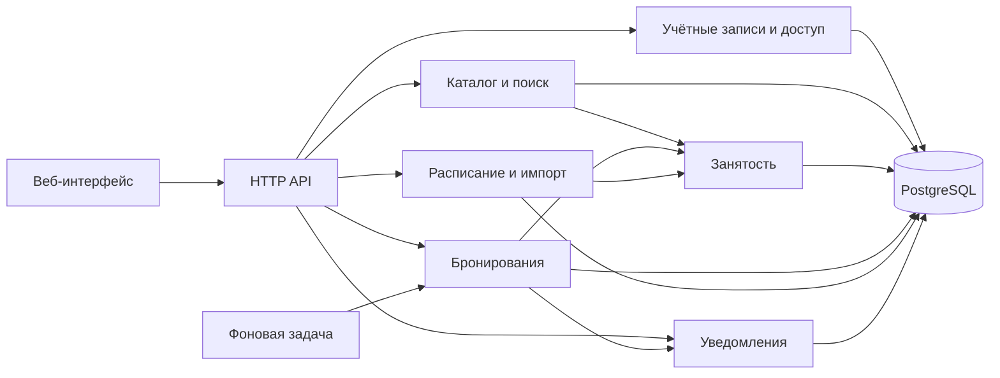

# Компонентная модель RoomBook

| Компонент | Ответственность | Основные данные |
|---|---|---|
| Учётные записи и доступ | Вход, проверка активности, сессии, проверка роли и владения записью | `users`, серверные сессии |
| Каталог и поиск | Корпуса, аудитории, оборудование, фильтры вместимости и доступности | `buildings`, `rooms`, `equipment`, `room_equipment` |
| Занятость | Интервалы основного расписания и подтверждённых броней, проверка пересечения, данные календаря | `schedule_entries`, `bookings` |
| Бронирования | Подача, подтверждение, отклонение, отмена, перенос и завершение. Запись причины и истории | `bookings`, `booking_status_history` |
| Расписание и импорт | Чтение CSV UTF-8 / XLSX, проверка строк и предпросмотр конфликтов, применение расписания диспетчером | `schedule_entries` |
| Уведомления | Список сообщений получателя, отметка о прочтении, запись сообщений при изменении статусов | `notifications` |
| Фоновая задача | Периодически передаёт модулю бронирований заявки и брони, у которых наступил срок смены статуса | Данные читает и изменяет через модуль бронирований |

HTTP API разбирает вход, сопоставляет запрос с прикладной операцией и возвращает результат. Правила переходов статуса сосредоточены в модуле бронирований. Модуль занятости строит календарь без раскрытия личных сведений автора чужой брони.
