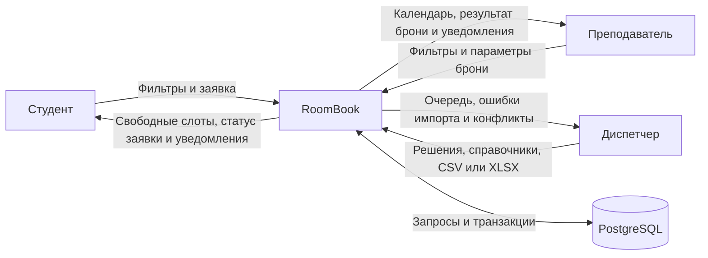
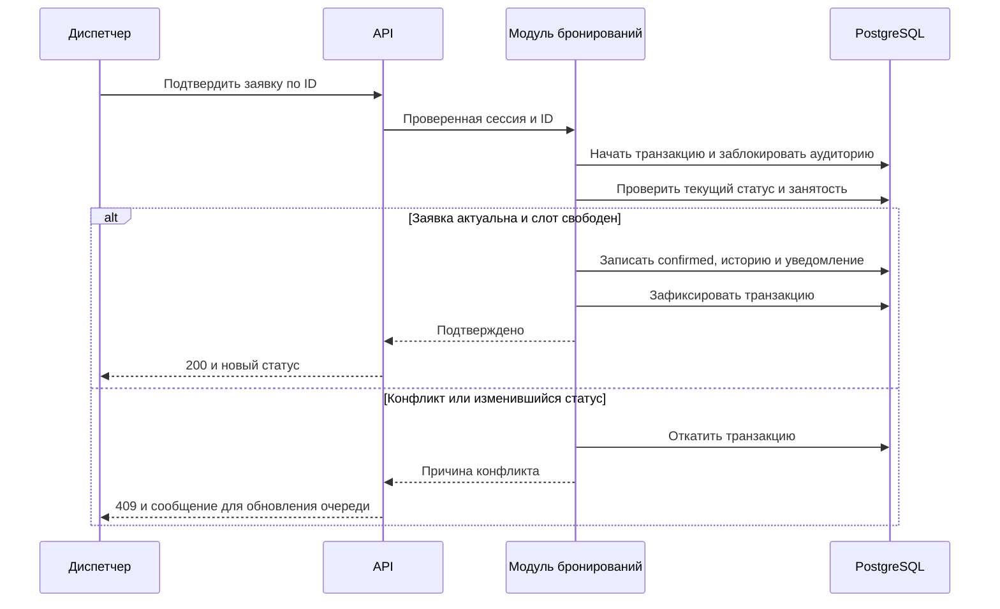

# Потоки данных RoomBook

## Контекст

Все пользовательские потоки идут через API после проверки сессии. Время слота задаётся локальной датой и временем университета. Границы интервала — `[начало, окончание)`.

| Поток | Вход | Обработка и хранилище | Результат |
|---|---|---|---|
| Поиск и календарь | Дата, интервал, корпус, вместимость, оборудование | Сервер читает каталог, занятия нужного дня недели и действующие подтверждённые брони. Заявки на рассмотрении слот не занимают | Доступные аудитории или интервалы занятости |
| Подача и подтверждение | Аудитория, дата, время, цель, число участников. Для решения диспетчера — ID заявки и решение | Сервер проверяет доступ, часы работы, вместимость и конфликты. Сохраняет бронь, историю и необходимые уведомления | `pending` для студента, `confirmed` для преподавателя при свободном слоте. Для диспетчера — итог решения или конфликт |
| Отмена или перенос | ID брони, новый интервал при переносе или причина при отмене диспетчером | Проверяются права и срок. Перенос подтверждённой брони студента возвращает её на рассмотрение. Изменения фиксируются с историей | Новый статус и обновлённая занятость |
| Импорт расписания | Файл CSV UTF-8 / XLSX от диспетчера | Сервер проверяет строки и принадлежность аудиторий, строит предпросмотр. Перед сохранением проверяет конфликты заново с блокировкой затронутых аудиторий | Отчёт об ошибках или конфликтах либо сохранённое расписание |
| Уведомления | Сессия и, при отметке о прочтении, ID уведомления | Сервер читает или меняет `notifications` с фильтром по получателю | Список сообщений и состояние прочтения |

## Подтверждение заявки

