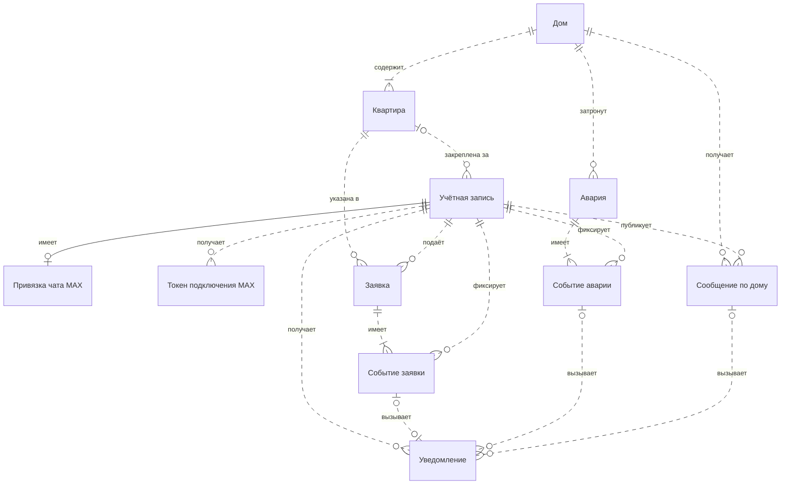

# Логическая схема БД «Подъезд Онлайн»

Команда 14. Связи уточняют [модель предметной области](../03-Системный%20аналитик/Модель%20предметной%20области.pdf) для хранения данных.

- У жителя одна квартира. К одной квартире могут быть привязаны несколько жителей. Диспетчер и администратор входят как сотрудники УК без привязки к квартире.
- Номер квартиры уникален в пределах дома. Код квартиры однозначно указывает на квартиру и подходит для регистрации нескольких жильцов.
- У заявки есть автор, квартира на момент подачи, описание и необязательное фото. События фиксируют создание и смену статуса. Текущий статус используется в списках, история доступна в карточке.
- События аварии фиксируют публикацию, перенос срока и устранение. В карточке хранится актуальный срок. Дом остаётся тем же на протяжении истории аварии.
- У уведомления ровно один источник из трёх, показанных на схеме. Смена статуса заявки уведомляет её автора. Событие аварии и сообщение по дому создают по уведомлению для каждого текущего жителя этого дома.
- Уведомление хранится для личного кабинета и содержит результат доставки в MAX. Токен подключения действует ограниченное время и используется один раз. Активная привязка хранит идентификатор чата.

См. [физическую схему](Физическая%20схема.md) и [описание БД](Описание%20БД.md).