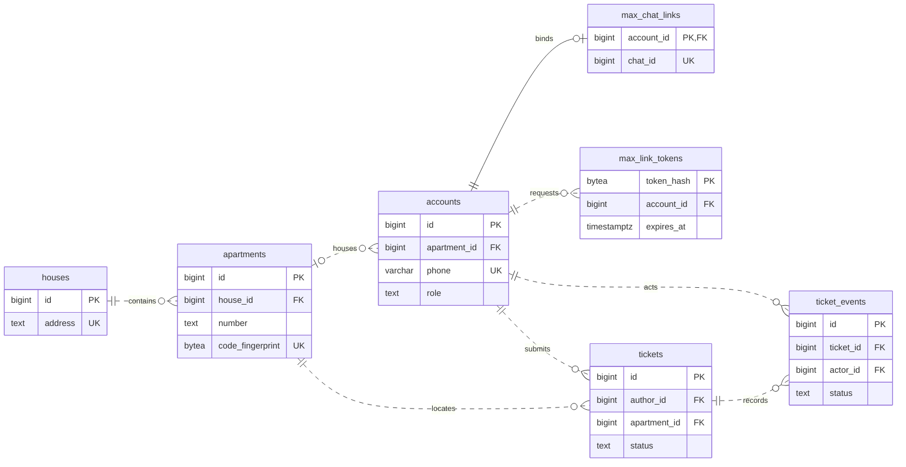
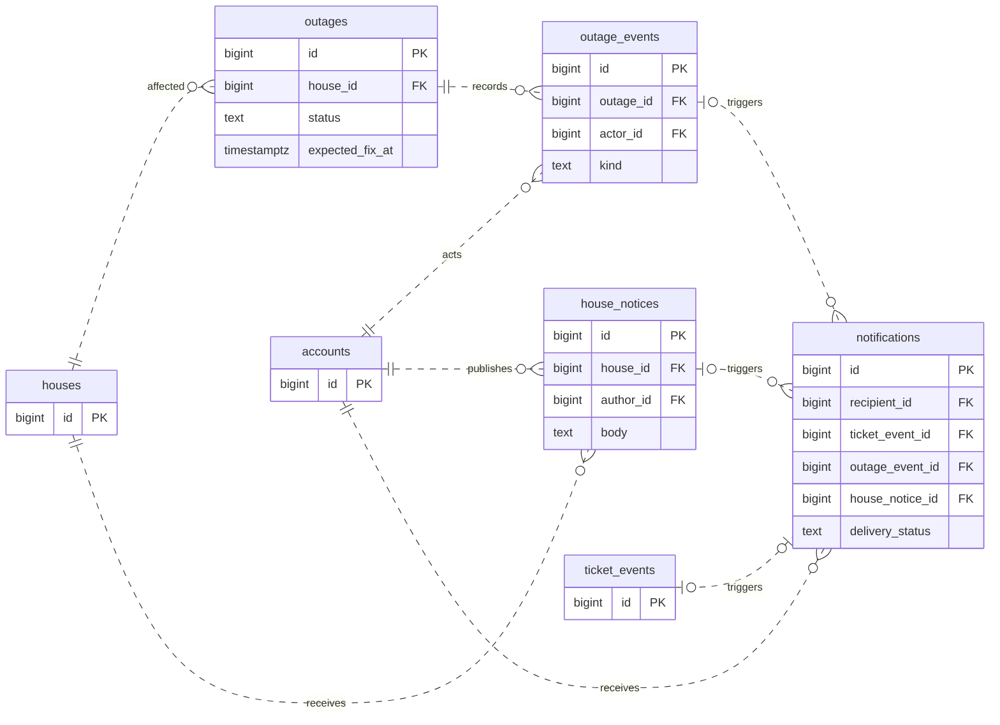

# Физическая схема БД «Подъезд Онлайн»

Команда 14. Целевая СУБД — PostgreSQL по [нефункциональным требованиям](../03-Системный%20аналитик/Нефункциональные%20требования.md). Схема реализована в [01_create_database.sql](sql/01_create_database.sql).

Диаграммы разделены на два блока для читаемости; общие таблицы показаны повторно. Они показывают ключи и основные поля. Полный состав приведён в таблице ниже. Уникальность адреса задаётся индексом по нормализованному значению, номера квартиры — парой `(house_id, number)`.

Все поля обязательны, кроме помеченных `NULL`. `id` — `bigint GENERATED ALWAYS AS IDENTITY PRIMARY KEY`. Обозначения PK, FK и UQ соответствуют первичному, внешнему и уникальному ключам (`UK` на диаграмме). Поля времени имеют тип `timestamptz`. Для `created_at`, `published_at` и `linked_at` используется `DEFAULT now()`. Начальные значения: `tickets.status = 'new'`, `outages.status = 'active'`, `notifications.attempt_count = 0`.

| Таблица | Поля PostgreSQL |
| --- | --- |
| `houses` | `id`, `address text`, `created_at timestamptz` |
| `apartments` | `id`, `house_id bigint FK houses`, `number text`, `code_fingerprint bytea UQ`, `code_encrypted bytea` |
| `accounts` | `id`, `apartment_id bigint NULL FK apartments`, `name text`, `phone varchar(11) UQ`, `password_hash text`, `role text`, `created_at timestamptz` |
| `max_chat_links` | `account_id bigint PK FK accounts`, `chat_id bigint UQ`, `linked_at timestamptz` |
| `max_link_tokens` | `token_hash bytea PK`, `account_id bigint FK accounts`, `created_at timestamptz`, `expires_at timestamptz`, `consumed_at timestamptz NULL` |
| `tickets` | `id`, `author_id bigint FK accounts`, `apartment_id bigint FK apartments`, `entrance text NULL`, `description text`, `photo_mime text NULL`, `photo_data bytea NULL`, `status text`, `created_at timestamptz` |
| `ticket_events` | `id`, `ticket_id bigint FK tickets`, `actor_id bigint FK accounts`, `status text`, `created_at timestamptz` |
| `outages` | `id`, `house_id bigint FK houses`, `kind text`, `description text`, `expected_fix_at timestamptz`, `status text`, `created_at timestamptz`, `resolved_at timestamptz NULL` |
| `outage_events` | `id`, `outage_id bigint FK outages`, `actor_id bigint FK accounts`, `kind text`, `expected_fix_at timestamptz`, `created_at timestamptz` |
| `house_notices` | `id`, `house_id bigint FK houses`, `author_id bigint FK accounts`, `body text`, `published_at timestamptz` |
| `notifications` | `id`, `recipient_id bigint FK accounts`, `ticket_event_id bigint NULL FK ticket_events`, `outage_event_id bigint NULL FK outage_events`, `house_notice_id bigint NULL FK house_notices`, `body text`, `delivery_status text`, `attempt_count integer`, `next_attempt_at timestamptz NULL`, `lease_until timestamptz NULL`, `sent_at timestamptz NULL`, `created_at timestamptz` |

## Ограничения

- Для `houses` уникальный индекс по `lower(btrim(address))`. Для `apartments` ключ `UNIQUE (house_id, number)`. Адрес непустой после удаления пробелов; номер непустой и хранится без пробелов по краям. Дом и его квартиры добавляются одной транзакцией.
- Для `accounts` телефон проверяется регулярным выражением `^[0-9]{11}$`. Допустимые роли — `resident`, `dispatcher`, `admin`. `apartment_id` обязателен для жителя и равен `NULL` для сотрудников. Приложение проверяет роль для каждой операции, где роль связанной учётной записи зависит от сценария.
- Для `max_link_tokens` проверяются `expires_at > created_at` и попадание `consumed_at` в интервал действия токена, если оно задано.
- Для заявки и её событий статусы `new`, `in_progress`, `closed`. Оба поля фото одновременно пусты или заполнены. Допустимы `image/jpeg` и `image/png`, размер `photo_data` от 1 до 5 242 880 байт. API проверяет содержимое изображения до сохранения.
- Для аварии типы `water`, `electricity`, `heating`, `elevator`, `other`, статусы `active` и `resolved`. `resolved_at` заполнено только для устранённой аварии и не раньше её создания. Виды событий `published`, `rescheduled`, `resolved`.
- Для уведомления `num_nonnulls(ticket_event_id, outage_event_id, house_notice_id) = 1`. Уникальные частичные индексы по `ticket_event_id`, `(outage_event_id, recipient_id)` и `(house_notice_id, recipient_id)` включают строки с соответствующим непустым источником. Они предотвращают повторное создание уведомления для того же события и получателя.
- Статусы доставки `unlinked`, `pending`, `processing`, `sent`, `failed`. `attempt_count` начинается с 0 и неотрицателен. `next_attempt_at` обязателен только в `pending`, `lease_until` только в `processing`, `sent_at` только в `sent`.
- Внешние ключи используют `ON DELETE RESTRICT` для сохранения истории.

## Индексы для рабочих запросов

| Запрос | Индекс |
| --- | --- |
| Найти жителей дома для рассылки | `accounts (apartment_id) WHERE role = 'resident'`. Квартиры дома находятся по ключу `(house_id, number)` |
| Мои заявки и список заявок диспетчера | `tickets (author_id, created_at DESC)`, `tickets (status, created_at DESC)` |
| История заявки | `ticket_events (ticket_id, id)` |
| Активные и устранённые аварии дома | `outages (house_id, status, created_at DESC)` |
| История аварии | `outage_events (outage_id, id)` |
| Лента дома и уведомления жителя | `house_notices (house_id, published_at DESC)`, `notifications (recipient_id, created_at DESC)` |
| Выборка на отправку и возврат заданий после сбоя | `notifications (next_attempt_at, id) WHERE delivery_status = 'pending'`, `notifications (lease_until, id) WHERE delivery_status = 'processing'` |
