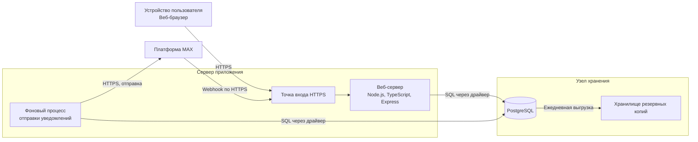

# Архитектура «Подъезд Онлайн»

## Размещение

Браузер получает страницы и обращается к HTTP API по одному HTTPS-адресу. Сервер приложения обслуживает сайт и принимает события MAX. На том же узле работает отдельный процесс отправки уведомлений. PostgreSQL доступна серверу приложения и обработчику по внутренней сети. MAX работает на стороне внешнего поставщика.

Сервер отдаёт HTML, CSS и JavaScript для трёх рабочих мест. Веб-сервер и обработчик используют одну PostgreSQL с [предметной схемой проекта](../05-Архитектор%20БД/Физическая%20схема.md). Очередь хранится в таблице `notifications`. При перезапуске обработчик продолжает работу по данным этой таблицы.

## Доступ

- После входа сервер выдаёт подписанную cookie с идентификатором учётной записи и временем истечения. Cookie использует `HttpOnly`, `Secure` и `SameSite=Lax`. Для изменяющих запросов из браузера сервер также проверяет `Origin`. При выходе cookie удаляется.
- Роль берётся из учётной записи. Для жителя сервер определяет квартиру и дом по сессии. Он проверяет владельца при чтении заявки и фото, дом при чтении аварии и получателя при чтении уведомления. Диспетчер работает с заявками, авариями и объявлениями. Администратор добавляет дома и выгружает коды.
- Пароли хешируются. Сервер хранит токен бота, секрет webhook, ключ подписи сессий и ключи для кодов квартир вне репозитория. Для webhook используется секрет подписки из заголовка `X-Max-Bot-Api-Secret`. [Подписка на события MAX](https://dev.max.ru/docs-api/methods/POST/subscriptions)
- Фотография заявки проходит проверку формата JPG/PNG и размера до 5 МБ. Её байты хранятся в PostgreSQL и загружаются при открытии карточки.

## Производительность и восстановление

По [нефункциональным требованиям](../03-Системный%20аналитик/Нефункциональные%20требования.md) система рассчитана на 20 домов, 2 000 жителей и 100 одновременных пользователей. При проверке время открытия страниц измеряется под этой нагрузкой с целевым пределом 3 секунды. Списки выдаются постранично, фотографии загружаются отдельно. Запросы списка заявок и ленты опираются на индексы раздела 05.

Для доставки аварий измеряется время от публикации до успешного ответа MAX. MAX рекомендует максимум 30 запросов в секунду. Если один запрос отправляет одно личное сообщение, то за минуту можно начать не более 1 800 отправок даже при идеальной загрузке. Для 2 000 получателей одна отправка на человека потребует около 67 секунд без учёта задержек и повторов. Цель в одну минуту нужно проверить для максимального числа подключённых жителей одного дома. Если сценарий включает рассылку всем 2 000 получателям, срок или способ доставки требует согласования. [Ограничение частоты запросов](https://dev.max.ru/docs-api/use-cases/event-notifications) · [Отправка сообщения](https://dev.max.ru/docs-api/methods/POST/messages/)

Обработчик ограничивает частоту запросов. После временной ошибки, ответа об ограничении частоты или истечения резерва он назначает повтор с задержкой, пока остаются попытки. Для постоянной ошибки и исчерпания попыток используется статус `failed`. Для контроля доставки измеряются возраст старейшего задания, задержка публикации и доля ошибок. Запись о событии видна в кабинете после фиксации транзакции.

Резервная копия PostgreSQL создаётся ежедневно и хранится отдельно от основного экземпляра. При проверке восстановления копию разворачивают на отдельном экземпляре, проверяют заявки с фотографиями и используют отдельно сохранённые ключи для проверки выгрузки кодов квартир.

[Компонентная модель](Компонентная%20модель.md) · [Потоки данных](Потоки%20данных.md)
