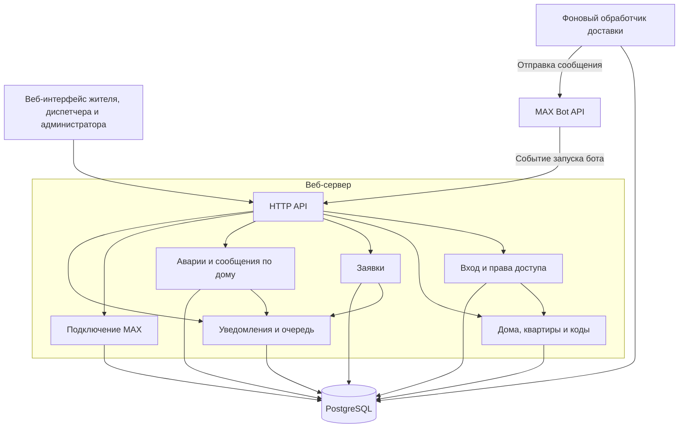

# Компонентная модель «Подъезд Онлайн»

Веб-интерфейс содержит три рабочих места из [макетов](../04-Дизайнер/Пользовательский%20интерфейс.pdf). HTTP API принимает запросы браузера, определяет пользователя и вызывает нужный модуль. Модули веб-сервера входят в одно приложение.

| Компонент | Ответственность |
| --- | --- |
| Веб-интерфейс | Показывает кабинет жителя, диспетчерскую или администрирование. Передаёт данные форм, обновляет списки и показывает ошибки. |
| Вход и права доступа | Регистрирует жителя по коду квартиры, проверяет пароль при входе, выдаёт сессию. Перед каждой операцией сервер проверяет роль и право на конкретную запись. |
| Дома, квартиры и коды | Добавляет дом с квартирами и создаёт коды. Находит квартиру по введённому коду. Даёт администратору выгрузить коды выбранного дома. |
| Заявки | Принимает описание и необязательное фото. Показывает жителю его заявки и историю, диспетчеру — общий список с возможностью сменить статус. |
| Аварии и сообщения по дому | Публикует аварии и объявления, обновляет срок или закрывает аварию. Формирует ленту жителя по его дому. |
| Подключение MAX | Выдаёт одноразовый токен с ограниченным сроком действия. Обрабатывает webhook от MAX и сохраняет привязку чата. |
| Уведомления и очередь | Создаёт запись для каждого получателя и показывает её в кабинете. Для подключённого чата та же запись служит заданием на отправку. |
| Фоновый обработчик доставки | Резервирует задания, обращается к MAX, записывает результат и планирует повторы. |
| PostgreSQL | Хранит справочники, учётные записи, заявки, события и очередь по [физической схеме](../05-Архитектор%20БД/Физическая%20схема.md). |

При смене статуса заявки модуль заявок и модуль уведомлений записывают изменения в одной транзакции PostgreSQL. Для аварий и объявлений действует тот же принцип. После фиксации записи доступны кабинету и фоновому обработчику.

[Архитектура размещения](Архитектура.md) · [Потоки данных и API](Потоки%20данных.md)
