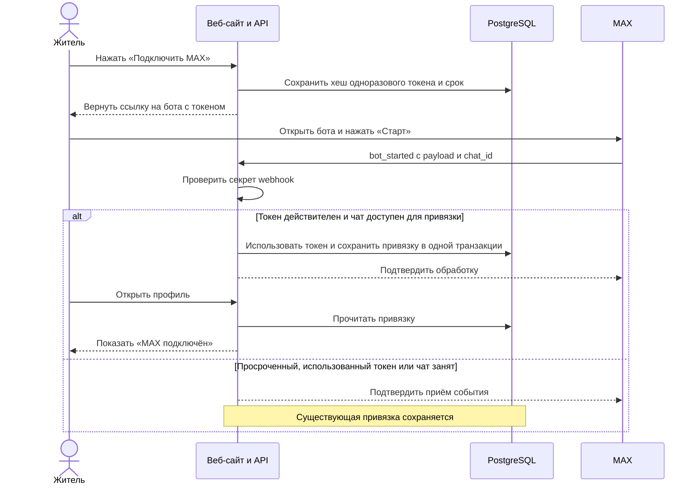
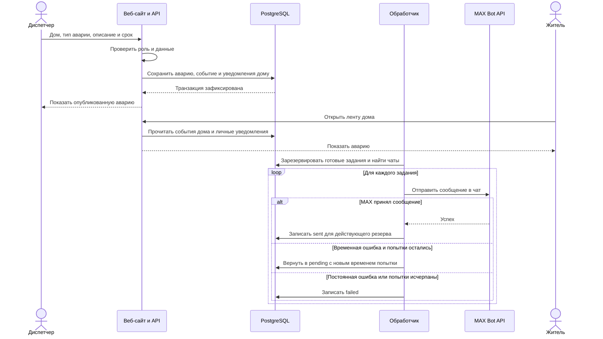
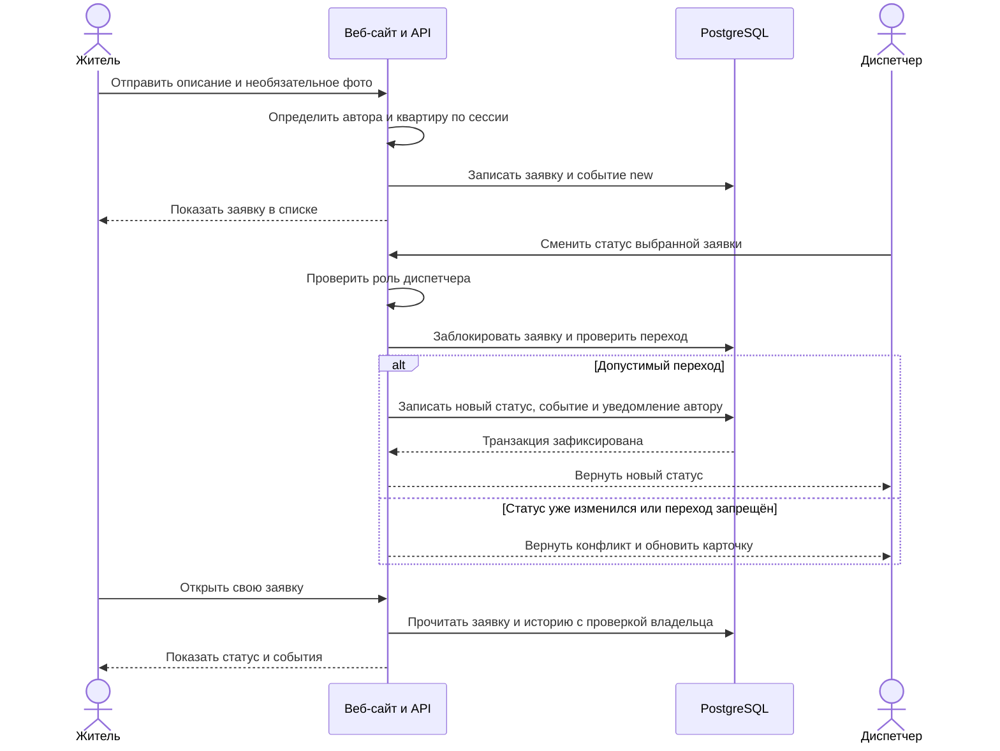

# Потоки данных «Подъезд Онлайн»

Маршруты описывают интерфейс целевого приложения. Браузер отправляет JSON. При создании заявки с фотографией используется `multipart/form-data`. HTTP API проверяет входные данные, сессию, роль и принадлежность запрошенной записи пользователю.

| Сценарий | Обмен с сервером | Данные и результат |
| --- | --- | --- |
| БП-1. Регистрация и вход | `POST /api/registration/apartment`, `POST /api/registration`, `POST /api/session`, `DELETE /api/session` | По коду сервер возвращает адрес для подтверждения. При регистрации он повторно проверяет код и подтверждённую квартиру, сохраняет аккаунт и хеш пароля. При входе проверяет пароль, устанавливает cookie и возвращает роль. |
| БП-2. Подключение MAX | `POST /api/max/link`, `POST /api/max/webhook`, `GET /api/profile` | Первый запрос выдаёт ссылку на бота, webhook передаёт токен и ID чата. Кабинет читает состояние привязки из профиля. |
| БП-3 и БП-4. Аварии | `GET /api/dispatch/houses`, `POST /api/dispatch/outages`, `GET /api/dispatch/outages`, `GET /api/dispatch/outages/{id}`, `PATCH /api/dispatch/outages/{id}` | Для формы сервер выдаёт список домов. Диспетчер указывает дом, тип, описание и срок или меняет существующую аварию. Сервер фиксирует аварию, событие и уведомления нужному дому. |
| БП-5. Заявки | `POST /api/tickets`, `GET /api/tickets`, `GET /api/tickets/{id}`, `GET /api/dispatch/tickets`, `PATCH /api/dispatch/tickets/{id}/status` | Житель подаёт заявку с описанием, подъездом и необязательным фото. В карточке он получает историю, фото доступно через `GET /api/tickets/{id}/photo` владельцу и диспетчеру. Диспетчер меняет статус, уведомление получает автор. |
| БП-6. Сообщения по дому | `GET /api/dispatch/notices`, `POST /api/dispatch/notices`, `GET /api/feed` | Диспетчер передаёт дом и текст, затем видит опубликованное сообщение в списке. Веб-лента жителя возвращает объявления, аварии его дома и личные уведомления. |
| БП-7. Дома и коды | `POST /api/admin/houses`, `GET /api/admin/houses`, `GET /api/admin/houses/{id}/codes` | Администратор передаёт адрес и номера квартир. Для формы с количеством квартир веб-интерфейс формирует список от 1 до введённого числа. Сервер создаёт дом, квартиры и коды одной транзакцией. Выгрузка доступна администратору. |

При ошибке проверки API возвращает код HTTP и описание для формы. Ошибка в данных формы получает `400`, отсутствие сессии — `401`, неподходящая роль — `403`, недоступная пользователю или отсутствующая запись — `404`, конфликт текущего статуса — `409`. Ошибка до фиксации откатывает записи операции.

## Подключение уведомлений в MAX

Токен из ссылки передаётся в поле `payload` события `bot_started`. Обработка повторно полученного события с уже использованным токеном не меняет состояние. Токен и привязка хранятся в `max_link_tokens` и `max_chat_links`. [Ссылки запуска бота](https://dev.max.ru/docs/chatbots/bots-coding/prepare/) · [Объект Update](https://dev.max.ru/docs-api/objects/Update/)

## Публикация аварии и рассылка

Жителей выбирают по связям `houses → apartments → accounts`. Записи для жителей с чатом MAX получают статус `pending`, для остальных — `unlinked`. Перенос срока и закрытие аварии создают отдельные строки в `outage_events`. Для объявления источником уведомления служит строка в `house_notices`. [Описание БД и очереди](../05-Архитектор%20БД/Описание%20БД.md)

## Подача заявки и смена статуса

Допустимые переходы заявки — `new → in_progress → closed`. Уведомление о смене статуса отправляется тем же обработчиком, что и сообщение об аварии, с одним получателем. Пример транзакции смены статуса приведён в [03_queries.sql](../05-Архитектор%20БД/sql/03_queries.sql).
